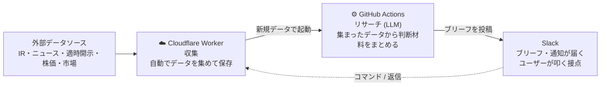

# stock-signals

半導体まわりの日本株を対象にした、ニュース駆動のリサーチ支援システム。
公式IR・ニュース・適時開示・株価などを自動で収集し、銘柄ごとの「生きたコンテキスト」を育てながら、
**判断材料 (材料ブリーフ)** を Slack に流し続ける。売買判断そのものは行わず、判断は読み手 (人間) が
行う。本リポは「ニュースリサーチと判断材料を非同期で並べ続ける装置」。対象は数日〜3週間保有のスイング。

## セットアップ

```sh
make setup
```

その後 `worker/.dev.vars` に実値を埋める。

## 全体構成

収集は Cloudflare Worker、リサーチは GitHub Actions 上の Claude Code(LLM)で
完結する完全クラウド構成。Worker が cron で集めた新規データを起点に、
`context-builder` → `ticker-brief` の2段が `repository_dispatch` で連鎖する。



この図は3環境の流れだけを示す。各部の設計判断は後述の「構成思想」、
実装の詳細(テーブル構成・エンドポイント・skill の入出力)はコードが真のソース。

上の図は**ユーザーが何もせず自動で受け取るもの**: 寄り前のマーケットブリーフ、新着データを起点にした
材料ブリーフ、コンテキスト更新、新規IR通知。これらは Worker の cron / dispatch で勝手に流れる。
**ユーザーが Slack から能動的に叩けるもの**は後述の「Slack からの能動操作」を参照。

### Slack に流れてくるもの (自動)

ユーザーが何もせず自動で Slack に届く出力は次の6種類。

- **材料ブリーフ**: 新着 IR/ニュースがあった銘柄について、新着材料の要約と背景・影響分析
  (何が起きたか・なぜ重要か・業績/株価への波及経路・過去の類似例)、強気材料/弱気材料の整理、
  次に確認すべき事実が流れる。LLM は Web 検索で一次情報・海外報道・アナリスト見解の裏取りも行い、
  出典を明記する。buy/sell の方向・指値・損切りは出さない — 判断は読み手に委ねる。末尾には
  投稿スクリプトが実在データから決定論で組んだ**注目水準** (現値/MA5/MA25/20日レンジ/ATR) と、
  該当があれば強制フロー観測 (追証売り/踏み上げ) と指数リバランス窓が観測事実として相乗りする。
- **マーケットブリーフ**: 寄り前に市場全体の事実サマリーを 1 本出す。前夜の米指数の実数・日経先物・
  場中に同時進行で動くアジア指数 (日経225・KOSPI)・セクター動向・当日イベント・市場テーマ見出し
  (半導体/AI/金利/米国市場/市況) を整理し、今日効く数字を指摘する。地合いラベルや売買可否は出さない。
  米国休場明けの朝は前夜の米指数が「前営業日に日本市場が消化済みの持ち越し値」だと識別し、
  新しい材料としては扱わない。
- **コンテキスト更新**: context-builder が銘柄コンテキストを育てるたび、更新後の全文をセクション
  ごとに区切ってコンテキスト更新チャンネルに投稿する (ブリーフチャンネルとは分離)。コンテキストの育ちを覗く窓。
- **新規IR**: 新着IRを通知する。ブリーフとは別チャンネルに分けることもできる。
- **新規ニュース**: 新着の銘柄ニュース・市場テーマニュース (半導体/AI/金利/米国市場/市況) の見出しを通知する。
  IR・ブリーフとは別のニュース専用チャンネルに分けることもできる (未設定なら通知しない)。
- **イベントリマインダー**: 重要イベント (監視銘柄の決算発表 / FOMC / 日銀会合 / 海外・国内ピア決算 /
  SQ / 指数リバランス / 指数採用・除外) の 3日前・前日・当日の朝に予告を1本流す。該当がない朝は流れない。
  専用チャンネルに分けることもできる (未設定ならブリーフと同じチャンネル)。
- **収集異常の警告**: 収集元ページが取得できているのに記事一覧が 0 件しかパースできない状態
  (= サイト側の構造変更で収集が静かに止まっている疑い) を検知すると、朝夕の収集時に警告を1本流す。

### Slack からの能動操作

ユーザーが Slack から能動的に叩けるのは次の通り(コマンドは引数なしなら銘柄ピッカーが出る)。

| 操作 | できること |
| ---- | ---- |
| `/brief [銘柄]`      | 任意のタイミングで材料ブリーフを出す(自動ブリーフと同じ skill を手動起動) |
| `/crash [銘柄]`      | 暴落プリモーテム。崩れる道筋を銘柄固有/マクロの両面で3〜5本列挙するリスク棚卸し |
| `/context [銘柄]`    | その銘柄の保存済み living context 全文を context チャンネル(`SLACK_CONTEXT_CHANNEL`)へ流す。解析は走らず D1 の保存結果を表示するだけ |
| `/position`          | 保有建玉を登録する(Slack ユーザー単位)。平均建値・株数を直接上書きする。スレッド返信時に本人の含み損益として効き、引け後のポジション事実レポート DM の対象になる。株数 0 で手仕舞い |
| `/trade`             | 約定 1 回(買い増し / 部分決済)を既存建玉に反映する。増しは加重平均で平均建値を再計算、減らしは平均建値据え置きで株数だけ減算(0 株で手仕舞い)。対象が無い増しは新規建玉になる |
| `/profile`           | 好み・特記事項(リスク許容度/保有スタイル/最大ポジション率/投資余力(現金残高)/メモ)を登録する(Slack ユーザー単位)。スレッド返信時に本人の売買スタイルとして効く |
| `/portfolio`         | 全建玉+現金を 1 画面で一括編集する。現在の建玉が `コード 現物\|信用 買\|売 建値 株数` の 1 行 1 建玉で prefill され、本文を書き換えて一括保存(行を消す=手仕舞い / 値を書き換える=更新 / 行を足す=新規)。保存時に本人の建玉を丸ごと置換する。銘柄ごとに `/position` `/trade` を開き直さず一度にまとめて直したいとき用 |
| `/mystatus`          | 登録済みのプロフィールと全保有建玉(建玉金額・含み損益(円/%)付き)、信用建玉があれば委託保証金維持率と追証ライン(20%到達までの評価損余力)を本人にだけ表示する。追証は現金残高+現物の代用評価(現値×80%)+評価損益からの概算。`/position` `/profile` の確認用で、登録は変えない |
| 解析投稿にスレッド返信 | 同じスレッドで Claude と対話する。コンテキスト+数値+本人の建玉と好みを読んで答える。必要なら Web 検索で追加取材する。売買の推奨はせず、材料と数字を並べて判断材料を返す |

### 監視銘柄の追加・削除

`update-tickers` skill を手で叩く(`add <code>` / `remove <code>`)。追加後は通常の cron / workflow が
その銘柄のデータを拾い始める。削除は watchlist から外すだけ(収集済みの D1 データはそのまま残す)。

### LLM連鎖 (新規データ検知 → Slack)

ここまでの自動出力を生む内部配管。Worker が新規 IR/ニュース/開示/レーティングを検知すると、
`context-builder`(銘柄コンテキストを更新)→ `ticker-brief`(判断材料をまとめる)が dispatch で
連鎖し、Slack に流れる。ブリーフは新着材料があった銘柄だけに出る (新着ゼロの回はコンテキストも
ブリーフも動かない)。スレッド返信には `slack-reply` が同じスレッドへ返答する。各段の入出力は
workflow / skill が真のソース。

### Cron スケジュール

収集 (Worker) は JST 基準で寄り前・場中5分毎・引け後に走る(東証が開かない土日はスキップ)。
マーケットブリーフ (`market-brief`) は寄り前に出し、個別の材料ブリーフより先に届く。
引け後には、各ユーザーの建玉 (建値・含み損益) と各銘柄の最新材料ブリーフを読んだ
**ポジション事実レポート**を本人へ DM する。建玉の数値 (含み損益) は Worker が決定論で出し、
LLM は「建玉に関係する新着材料・リスクの紐付け」だけを行う (アクション提案や緊急度は出さない。
GitHub Actions の position-report、ユーザーは直列)。
具体的な cron 式と種別ごとの収集内容は Worker の設定が真のソース。

## 構成思想

全体像を踏まえた上での、各部の設計判断。

- **売買判断はシステムから出さない**。LLM の役割はニュースリサーチと判断材料の整理までで、
  buy/sell の方向・指値・損切り・建玉アクションは出力しない。判断は読み手 (人間) が行う。
- **決定論的な前処理はすべて Worker に寄せる**。記事・株価・ファンダ・適時開示・レーティングの取得・正規化は Worker が担い、LLM は集まった材料を読んで解説するだけにする。
- **リサーチは2段に分離**。前段 `context-builder` が銘柄ごとの生きたコンテキスト(経営判断・商品ラインナップ・技術ロードマップ + 直近の重大トピック)を育て、後段 `ticker-brief` がそのコンテキスト+価格/市場状況を読んで判断材料をまとめる。
- **数値は LLM に創作させない**。注目水準 (現値/MA/レンジ/ATR) や建玉の事実行 (建値/含み損益) は投稿スクリプトがデータ実在値から決定論で組む。LLM の出力は材料の要約・分析・紐付けに限る。
- **Web 検索は補助**。収集済みデータが主で、LLM の Web 検索は材料の裏取り (一次情報・海外報道・アナリスト見解) に限り、出典を明記する。見つからなければ書かない。
- **記事系は1つに合流**。公式IR・銘柄ニュース・適時開示(TDnet)・証券会社レーティングはすべて同じ記事ストアに集約し、収集元が増えてもリサーチ側は無改修で読む。銘柄に紐付かない市場テーマニュースだけは別ストアに分け、マーケットブリーフ (`market-brief`) が読む。ただし市場テーマ見出しに監視銘柄の名前・別名・製品ワードの言及があれば、その銘柄の個別ブリーフも起動する。
- **市場全体と個別を分ける**。`market-brief` が市場全体の事実サマリーを寄り前に1本出し、個別ブリーフはそれを当日の背景として参照する。ラベル (リスクオン/リスクオフ) には潰さず、事実のまま渡す。
- **ブリーフ本文に観測事実を相乗り**。強制フロー(追証売り/踏み上げ)とスケジュール型イベント(FOMC/日銀/SOX系ピア決算/国内ピア決算/指数リバランス/入替銘柄の発表窓/指数採用・除外)を、材料の解説とは別の観測事実としてブリーフに織り込む。

## ディレクトリ構成

| パス | 中身 |
| ---- | ---- |
| `worker/`            | Cloudflare Worker (収集) |
| `.github/workflows/` | LLMリサーチの Actions(market-brief / context-builder / ticker-brief / crash-scenario / slack-reply / position-report)・CI・デプロイ。リサーチのルールは各ワークフローの prompt にベタ書きし、数値コンテキストは `@` でファイルから取り込む |
| `agents/skills/`     | 手動運用の Claude Code skill(`update-tickers` ほか。`.claude/skills/` は symlink) |
| `scripts/`           | Slack 投稿整形・ブリーフ dispatch・手動ツール・品質ゲート(`verify.sh` 等) |
| `config/`            | sources / events / peers の人間向け設定。銘柄一覧の真ソースは `worker/src/lib/watchlist.ts` の `TICKERS` |

> Slack App の登録・Worker / GitHub Actions の secret 設定といった構築手順は、利用ではなく
> セットアップの領域なのでワークフロー (`.github/workflows/`) を参照。
