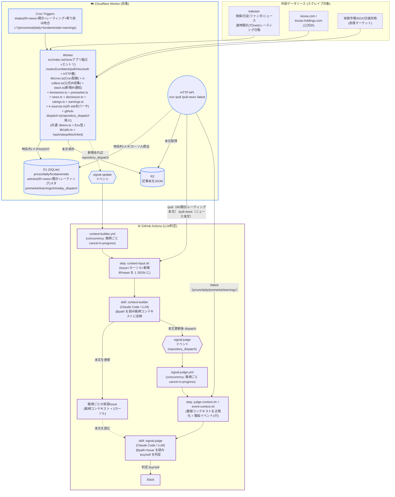
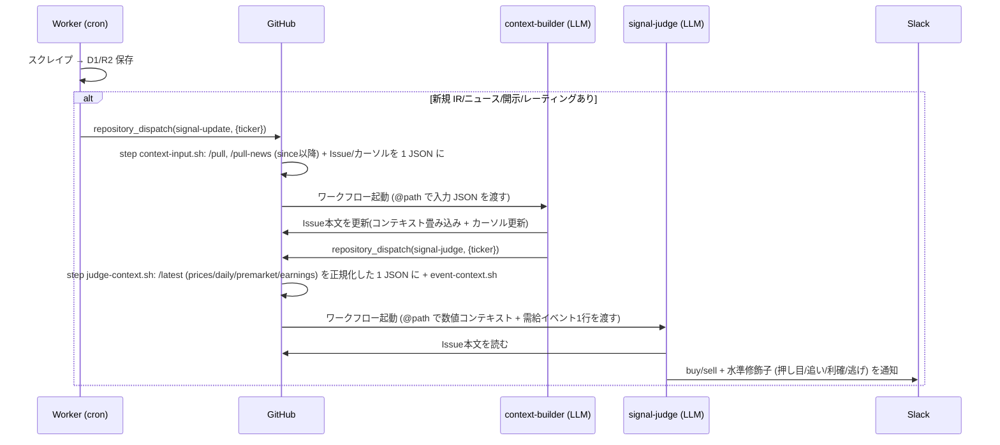

# stock-signals

日本株4銘柄(半導体)向けのニュース駆動シグナル生成リポジトリ。

## 構成思想

- **対象はスイング (数日〜3週間の保有)**。デイトレ用途ではない。秒・分単位の板情報や歩み値は取らない。
- **取引は手動**。本リポはあくまで「売買判断の材料」を非同期で並べ続ける装置。
- **完全クラウド**。収集は Cloudflare Worker、LLM判定は GitHub Actions。常駐プロセスもローカル cron も持たない。
- **収集はWorker (LLM不使用)**。記事・株価・ファンダ・適時開示・証券会社レーティングの取得は素のスクレイプなので Worker の cron trigger から直接実行。
- **判定はGitHub Actions上のClaude Code (LLM)**。新規データ取得をトリガーに skill (`.claude/skills/`) を起動する。
- **判定は2段に分離**。前段 `context-builder` が銘柄ごとの常設 Issue 本文を「持続コンテキスト(経営判断・商品ラインナップ・技術ロードマップ + 直近の重大トピック要約)」として育て、後段 `signal-judge` がそのコンテキスト+価格/地合いを読んで buy/sell を判定する。
- **判定は必ず buy か sell の2値**。hold も confidence スコアも出さない(薄い材料でも片側に倒す)。方向に「水準」修飾子 (押し目/追い/利確/逃げ) を添えて、トレンド内のどこにいるかを示す。
- **出力の住み分け**。Issue 本文 = 銘柄を読み解く生きたナレッジ(context-builder が書く)。判定 (buy/sell) = Slack に流れる(signal-judge が書く)。signal-judge は Issue を一切書き換えないので、判定→本文の編集ループは起きない。source of truth は時系列が D1、銘柄コンテキストが Issue 本文。
- **記事系は1テーブルに合流**。公式IR・銘柄ニュース・適時開示(TDnet)・証券会社レーティングはすべて `articles` テーブルに `source`/`ir_category` プレフィクス付きで保存する。専用テーブルは作らない。`/pull` の IR カーソルが `ir:% tdnet:% rating:%` を、`/pull-news` がニュースをまとめて返すので、収集元が増えても context-builder は無改修で読む。レーティングは目標株価が中期(6〜12ヶ月)ビューなので、context-builder が Issue 本文の専用セクションに畳み込む(直近トピックの30日ルールの例外)。

## 対象銘柄 (watchlist)

| code | name           | 備考                       |
| ---- | -------------- | -------------------------- |
| 285A | キオクシア     | 半導体メモリ               |
| 6857 | アドバンテスト | 半導体テスター             |
| 6920 | レーザーテック | 半導体検査装置             |
| 6981 | 村田製作所     | 電子部品(MLCC)             |

詳細とキーワード/IRソースは `config/watchlist.yaml` 参照。

## 全体構成

Cloudflare Worker (収集) と GitHub Actions (LLM判定) の2環境で完結する。
Worker が cron で集めた新規データを起点に、`context-builder` → `signal-judge` の2段が
`repository_dispatch` で連鎖する (詳細は構成思想を参照)。



### Cron スケジュール

Worker の cron trigger は UTC 基準 (`worker/wrangler.toml`)。JST 換算は以下。

| JST | cron式 (UTC) | 種別 | 内容 |
| --- | --- | --- | --- |
| 08:30 | `30 23 * * *` | intake | IR + ニュース + 適時開示(TDnet) + 証券会社レーティング + 地合い(寄り前のみ) |
| 20:00 | `0 11 * * *` | intake | IR + ニュース + 適時開示 + レーティング(決算・適時開示・レーティング日報を当夜に拾う) |
| 09:00–15:00 5分毎 | `*/5 0-6 * * *` | prices | 株価スナップショット + ニュース速報。12:30 相当スロットでは IR intake も相乗り。新着ニュースの dispatch は銘柄ごと 15分デバウンス (下記) |
| 16:00 | `0 7 * * *` | eod | 日足 + ファンダ + 決算日推定 |

### LLM連鎖 (新規データ検知 → Slack)



カーソルは Issue 本文に永続化されるため、前段のジョブが途中でキャンセルされても
カーソルは更新されず、次の発火で取りこぼし分を含めて再取得される (冪等)。

**場中ニュースのデバウンス**。場中 (prices cron, 5分毎) は同じ銘柄に短時間で複数の新着が出ると
スロットごとに独立して dispatch してしまい、LLM 2段 (context-builder→signal-judge) が数分おきに
連発する。これを抑えるため、Worker は銘柄ごとの最終 dispatch 時刻を D1 (`intraday_dispatch`) に持ち、
**15分以内に既に撃っていればその回は見送る**。見送っても新着記事はカーソル未更新のまま残り、窓が
明けた次スロットで context-builder がまとめて拾うので取りこぼしはない (判定はカーソル以降を全部読む)。
intake cron (寄り前/引け後) は地合い込みの重要判定なのでデバウンスせず常に dispatch する。
signal-judge は精度優先で `--effort high` (reasoning effort) で走る。

## ディレクトリ構成

| パス | 中身 |
| ---- | ---- |
| `worker/`            | Cloudflare Worker (収集) |
| `.github/workflows/` | LLM判定の Actions |
| `agents/skills/`     | Claude Code skill 実体 (`.claude/skills/` は symlink) |
| `scripts/`           | Actions 前処理 (`*.sh`) と手動ツール (`*.ts`) |
| `config/`            | watchlist / sources / events |

## 判定結果の見方

判定は GitHub Issue と Slack に出る。

- **GitHub Issue (銘柄コンテキスト)**: 銘柄ごとに `label: ir-report` + `label: ticker:<code>` の
  常設 Issue が1本あり、本文が銘柄コンテキスト + 末尾の 2カーソル。証券会社レーティング(機関・格付・目標株価)は
  本文の「証券会社レーティング」セクションに新しい順で畳み込まれる。**判定 (buy/sell) は本文には書かれない**。
- **Slack (判定)**: signal-judge が出す buy/sell + 水準修飾子 (押し目/追い/利確/逃げ) + 根拠が1行流れる。
  根拠には判定の核になった「直近の重大トピック」が引用される。寄り前 (intake cron) は地合いを
  取得してから新着のある銘柄の signal-judge を発火するので、寄り前判定も地合い込みで Slack に届く。

確認用スクリプトを手元で叩くこともできる (要 `WORKER_URL` 環境変数):

```sh
WORKER_URL=https://<your-worker> node scripts/valuation.ts
WORKER_URL=https://<your-worker> node scripts/sector.ts semiconductor
node scripts/events.ts --days 45
```

## 決算日メンテナンス

各銘柄の次回決算発表予定日は **Worker が eod cron (引け後1日1回) で自動推定**し D1 に保持する。
kabutan finance ページの四半期業績テーブルから「直近実績の次四半期 = 前年同期の発表日 +1年」で算出。
signal-judge はこれを読み、決算が5日以内なら原則 `sell` に倒す(de-risk into the print。最新コンテキスト
そのものが決算リリースの場合を除く。スイング前提で持ち越しガラを避けるため)。決算発表後は翌営業日の cron で
自動的に次の予定日へ繰り上がる。

`config/watchlist.yaml` の `next_earnings_date` は初期値/参考用。source of truth は D1。

## 証券会社レーティングメンテナンス

証券会社レーティング(個社別 目標株価)は **Worker が intake cron で kabutan のレーティング日報から自動収集**する。
日報は当日夕方〜夜に出揃うため、引け後 (20:00) intake で拾うと取りこぼしが少ない。watchlist 銘柄に
レーティング変更があった日だけ新規が出る (毎日は出ない)。

- データは専用テーブルを持たず `articles` に `source="rating:<firm>"` / `ir_category="rating"` で保存し、
  `/pull` の IR カーソルに合流する。context-builder は無改修で読み、Issue 本文の専用セクションに畳み込む。
- 信頼する証券会社は `worker/src/lib/ratings.ts` の `TRUSTED_FIRMS` で定義する。**ここに無い機関も捨てず保存し**、
  本文に「信頼度: 低」を付けて judge 側で割り引けるようにする (後でリストを変えても再取得不要)。
- レーティング収集対象の銘柄コードは `worker/src/lib/timeseries.ts` の `WATCHLIST` (Worker 全モジュール共通の唯一の定義) を参照する。watchlist を増やすときはここと `config/watchlist.yaml` だけ直す。

## イベントカレンダーメンテナンス

`config/events.yaml` に FOMC・SQ・日銀会合などのマクロ/需給イベントを手動で並べる
(個別決算とは別系統)。`scripts/events.ts` が「直近N日以内の未来イベント」を表示する。

- **四半期ごとに先の日程を追記**する。
  - FOMC / 日銀会合: 公式サイトの年間スケジュールから。米国イベントは結果が日本の
    翌営業日に効くので `jst_effect_date` を入れる。
  - SQ: 各月の第2金曜。3/6/9/12月はメジャーSQ (impact: high)、他月はオプションのみ
    (impact: medium)。祝日でズレる場合は実日付で上書き。
- 過去日になったイベントは消さなくてよい (`events.ts` は未来分のみ表示)。溜まったら整理。
