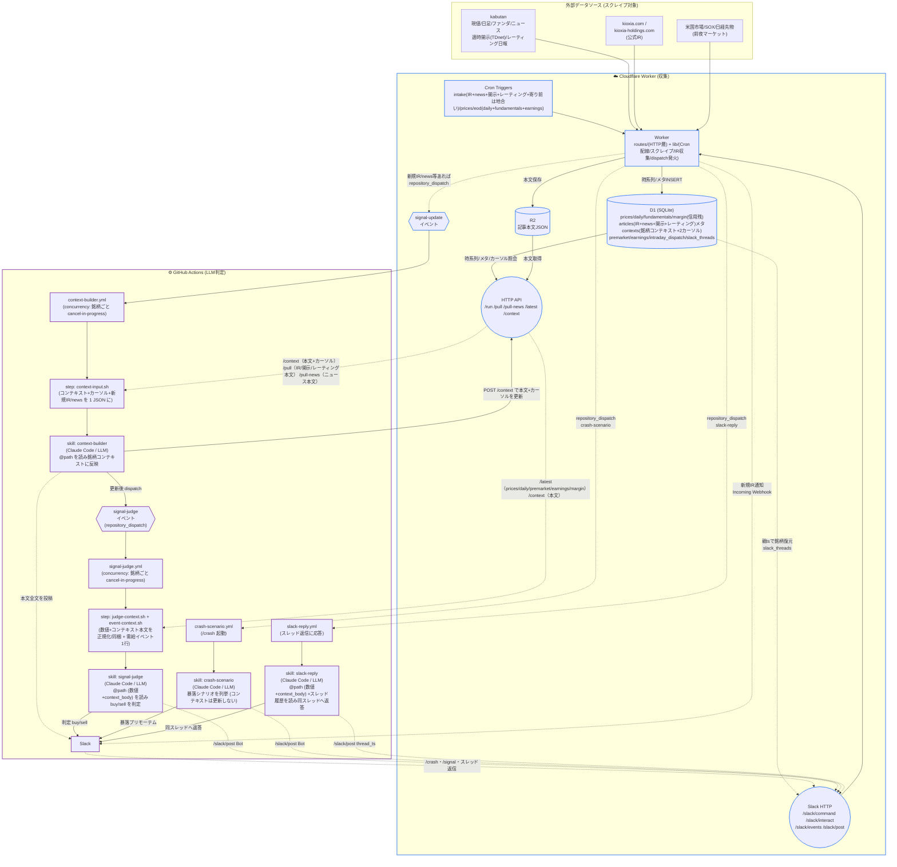
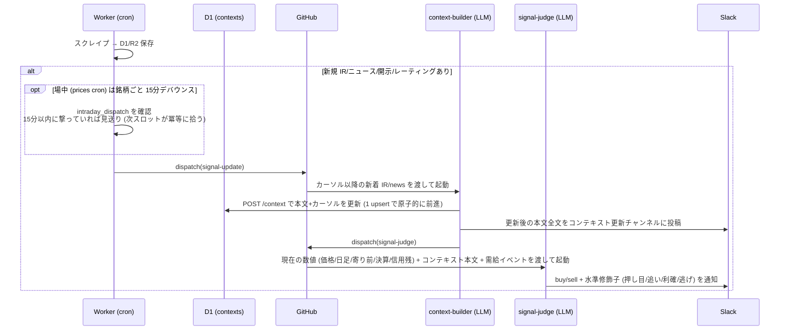
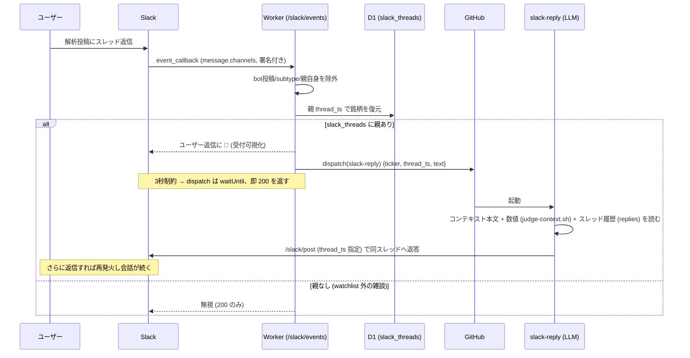
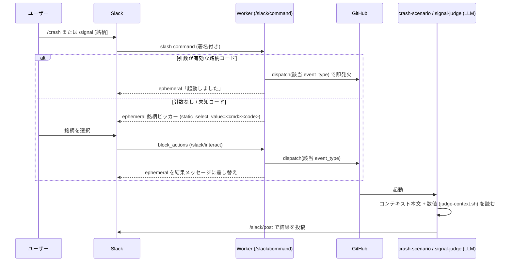

# stock-signals

日本株4銘柄(半導体)向けのニュース駆動シグナル生成リポジトリ。

## 構成思想

- **対象はスイング (数日〜3週間の保有)**。秒・分単位の板情報や歩み値は対象外。
- **取引は手動**。本リポは「売買判断の材料」を非同期で並べ続ける装置。
- **完全クラウド**。収集は Cloudflare Worker、LLM判定は GitHub Actions で完結する。
- **収集はWorker (LLM不使用)**。記事・株価・ファンダ・適時開示・証券会社レーティングの取得は素のスクレイプなので Worker の cron trigger から直接実行。
- **判定はGitHub Actions上のClaude Code (LLM)**。新規データ取得をトリガーに skill (`.claude/skills/`) を起動する。
- **判定は2段に分離**。前段 `context-builder` が銘柄ごとの **D1 コンテキスト** (Worker `/context`、`contexts` テーブル) を「持続コンテキスト(経営判断・商品ラインナップ・技術ロードマップ + 直近の重大トピック要約)」として育て、後段 `signal-judge` がそのコンテキスト+価格/地合いを読んで buy/sell を判定する。
- **判定は必ず buy か sell の2値**。薄い材料でも片側に倒す。方向に「水準」修飾子 (押し目/追い/利確/逃げ) を添えて、トレンド内のどこにいるかを示す。
- **出力の住み分け**。D1 コンテキスト = 銘柄を読み解く生きたナレッジ(context-builder が書く)。判定 (buy/sell) = Slack に流れる(signal-judge が書く)。コンテキストは人間が直接見るものではないが、更新のたび全文が Slack のコンテキスト更新チャンネル (`SLACK_CONTEXT_CHANNEL`) に投稿される(覗き窓)。
- **記事系は1つに合流**。公式IR・銘柄ニュース・適時開示(TDnet)・証券会社レーティングはすべて同じ記事ストアに保存され、収集元が増えても context-builder は無改修で読む。レーティングは目標株価が中期(6〜12ヶ月)ビューなので、context-builder がコンテキストの専用セクションに畳み込む(直近トピックの30日ルールの例外)。
- **補助: 暴落プリモーテム**。`crash-scenario` skill は signal-judge と同じインプット (コンテキスト + 数値) を読み、その銘柄が崩れる道筋を銘柄固有/マクロの両面で3〜5本列挙して Slack に流す。buy/sell 判定とは別物 (リスクの事前棚卸し)。起動は **Slack スラッシュコマンド `/crash` 専用**: `/crash 285A` なら即発火 / 引数なしなら watchlist から銘柄ピッカーが出る。GitHub 画面からの手動実行は持たない。
- **手動 buy/sell 判定**。`signal-judge` は通常 context-builder のあとに自動で走るが、**Slack スラッシュコマンド `/signal` でも任意のタイミングで起動できる**: `/signal 285A` なら即発火 / 引数なしなら銘柄ピッカー (`/crash` と同じ口を共有)。

## 対象銘柄 (watchlist)

| code | name           | 備考                       |
| ---- | -------------- | -------------------------- |
| 285A | キオクシア     | 半導体メモリ               |
| 6857 | アドバンテスト | 半導体テスター             |
| 6920 | レーザーテック | 半導体検査装置             |
| 6981 | 村田製作所     | 電子部品(MLCC)             |

詳細とキーワード/IRソースは `config/watchlist.yaml` 参照(銘柄一覧の唯一の真のソース)。

## 全体構成

Cloudflare Worker (収集) と GitHub Actions (LLM判定) の2環境で完結する。
Worker が cron で集めた新規データを起点に、`context-builder` → `signal-judge` の2段が
`repository_dispatch` で連鎖する (詳細は構成思想を参照)。

### Cron スケジュール

収集は JST 基準で以下のタイミングに走る(東証が開かない土日はスキップ)。

| JST | 種別 | 内容 |
| --- | --- | --- |
| 08:30 | intake | IR + ニュース + 適時開示(TDnet) + 証券会社レーティング + 地合い(寄り前のみ) |
| 20:00 | intake | IR + ニュース + 適時開示 + レーティング + 信用残(週次の需給。引け後にだけ相乗り) |
| 09:00–15:00 5分毎 | prices | 株価スナップショット + ニュース速報。12:30 相当スロットでは IR intake も相乗り |
| 16:00 | eod | 日足 + ファンダ + 決算日推定。**月初 (1〜3日)** はマクロイベント(FOMC/日銀)も相乗り収集 |

### LLM連鎖 (新規データ検知 → Slack)

カーソル(`ir_last_fetched_at` / `news_last_fetched_at`)は `contexts` 行に本文と同じ行で持ち、
context-builder が POST /context で **本文とカーソルを1回の upsert で原子的に前進させる**
(本文だけ進む/カーソルだけ進む を構造的に排除)。前段のジョブが途中でキャンセルされても
カーソルは更新されず、次の発火で取りこぼし分を含めて再取得される (冪等)。判定はカーソル以降を全部読む。

### スレッド返信で対話 (Slack → Worker → slack-reply)

判定/プリモーテムの投稿にスレッド返信すると、同じスレッドへ Claude が返答する。

### スラッシュコマンド起動 (/crash 暴落プリモーテム・/signal buy/sell 判定)

`/crash` と `/signal` は同じ `/slack/command` の口を共有し、コマンド名で撃つ event_type
(crash-scenario / signal-judge) を切り替える。下図は `/crash` の例。`/signal` も流れは同じで、
dispatch 先が signal-judge、投稿内容が buy/sell 判定になる。

**場中ニュースのデバウンス**。場中 (5分毎) は同じ銘柄に短時間で複数の新着が出ると判定が数分おきに
連発するため、**15分以内に既に撃っていればその回は見送る** (見送り分は冪等性で次スロットがまとめて拾う)。
寄り前/引け後の intake は地合い込みの重要判定なのでデバウンスせず常に判定する。

## ディレクトリ構成

| パス | 中身 |
| ---- | ---- |
| `worker/`            | Cloudflare Worker (収集) |
| `.github/workflows/` | LLM判定の Actions / CI (`ci.yml` で `pnpm run verify`) / dependabot 自動マージ |
| `agents/skills/`     | Claude Code skill 実体 (`.claude/skills/` は symlink) |
| `scripts/`           | Actions 前処理 (`*.sh`) と手動ツール (`*.ts`) |
| `config/`            | watchlist / sources / events |

## 判定結果の見方

判定は Slack に出る。銘柄コンテキストは D1 に蓄積され、人間向けには更新のたび Slack に流れる。

- **D1 コンテキスト (銘柄コンテキスト)**: 銘柄ごとに `contexts` テーブルの1行があり、本文(銘柄
  コンテキスト) + 2カーソル(`ir_last_fetched_at` / `news_last_fetched_at`)を持つ。`GET /context?code=`
  で読める。人間が直接見るものではなく、context-builder が書き signal-judge / crash-scenario /
  slack-reply が読む内部ストア。
- **Slack (コンテキスト更新)**: context-builder が D1 を更新するたび、更新後の本文全文を
  コンテキスト更新チャンネル (`SLACK_CONTEXT_CHANNEL`) に投稿する。人間がコンテキストの育ちを
  覗くための窓 (判定チャンネルとは分離)。
- **Slack (判定)**: signal-judge が出す buy/sell + 水準修飾子 + 根拠が1行流れる。
  根拠には判定の核になった「直近の重大トピック」が引用される。寄り前は地合いを取得してから
  新着のある銘柄の判定を発火するので、寄り前判定も地合い込みで Slack に届く。
- **Slack (新規IR)**: Worker が新着IRを通知する。判定とは別チャンネルに分けることもできる。
- **Slack (暴落プリモーテム)**: スラッシュコマンド `/crash 285A` で即起動、`/crash` 単独なら
  銘柄ピッカーが出る。結果は判定と同じチャンネルに暴落シナリオ3〜5本が届く。
- **Slack (スレッド返信で対話)**: 判定/プリモーテムの投稿に**スレッド返信すると Claude が同じ
  スレッドへ返事を返す**。銘柄コンテキスト (生きたナレッジ) + 現在の数値 + スレッド履歴を読んで
  返答し、さらに返信すれば会話が続く。Bot 自身の投稿やスレッド外の発言には反応しない。

> Slack App の登録・Worker / GitHub Actions の secret 設定といった構築手順は、利用ではなく
> セットアップの領域なので各 skill (`agents/skills/`) とワークフロー (`.github/workflows/`) を参照。