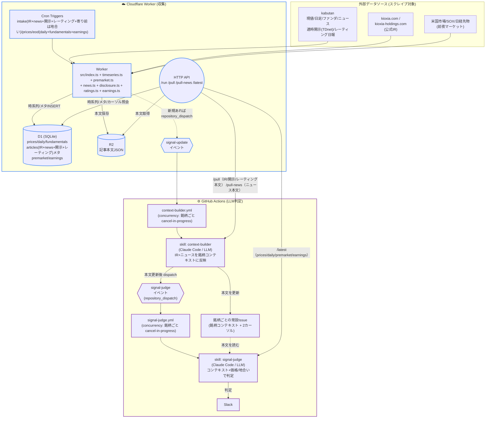
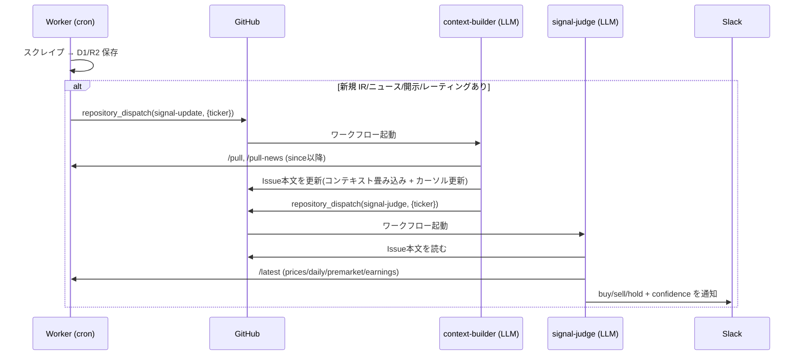

# stock-signals

日本株4銘柄(半導体)向けのニュース駆動シグナル生成リポジトリ。

## 構成思想

- **対象はスイング (数日〜3週間の保有)**。デイトレ用途ではない。秒・分単位の板情報や歩み値は取らない。
- **取引は手動**。本リポはあくまで「売買判断の材料」を非同期で並べ続ける装置。
- **完全クラウド**。収集は Cloudflare Worker、LLM判定は GitHub Actions。常駐プロセスもローカル cron も持たない。
- **収集はWorker (LLM不使用)**。記事・株価・ファンダ・適時開示・証券会社レーティングの取得は素のスクレイプなので Worker の cron trigger から直接実行。
- **判定はGitHub Actions上のClaude Code (LLM)**。新規データ取得をトリガーに skill (`.claude/skills/`) を起動する。
- **判定は2段に分離**。前段 `context-builder` が銘柄ごとの常設 Issue 本文を「持続コンテキスト(経営判断・商品ラインナップ・技術ロードマップ + 直近の重大トピック要約)」として育て、後段 `signal-judge` がそのコンテキスト+価格/地合いを読んで buy/sell/hold を判定する。
- **出力の住み分け**。Issue 本文 = 銘柄を読み解く生きたナレッジ(context-builder が書く)。判定 (buy/sell/hold) = Slack に流れる(signal-judge が書く)。signal-judge は Issue を一切書き換えないので、判定→本文の編集ループは起きない。source of truth は時系列が D1、銘柄コンテキストが Issue 本文。
- **記事系は1テーブルに合流**。公式IR・銘柄ニュース・適時開示(TDnet)・証券会社レーティングはすべて `articles` テーブルに `source`/`ir_category` プレフィクス付きで保存する。専用テーブルは作らない。`/pull` の IR カーソルが `ir:% tdnet:% rating:%` を、`/pull-news` がニュースをまとめて返すので、収集元が増えても context-builder は無改修で読む。レーティングは目標株価が中期(6〜12ヶ月)ビューなので、context-builder が Issue 本文の専用セクションに畳み込む(直近トピックの30日ルールの例外)。

## 対象銘柄 (watchlist)

| code | name           | 備考                       |
| ---- | -------------- | -------------------------- |
| 285A | キオクシア     | 半導体メモリ               |
| 6857 | アドバンテスト | 半導体テスター             |
| 6920 | レーザーテック | 半導体検査装置             |
| 6981 | 村田製作所     | 電子部品(MLCC)             |

詳細とキーワード/IRソースは `config/watchlist.yaml` 参照。

## 全体構成

Cloudflare Worker (収集) と GitHub Actions (LLM判定) の2環境で完結する。
Worker が cron で集めた新規データを起点に、`context-builder` → `signal-judge` の2段が
`repository_dispatch` で連鎖する (詳細は構成思想を参照)。



### Cron スケジュール

Worker の cron trigger は UTC 基準 (`worker/wrangler.toml`)。JST 換算は以下。

| JST | cron式 (UTC) | 種別 | 内容 |
| --- | --- | --- | --- |
| 08:30 | `30 23 * * *` | intake | IR + ニュース + 適時開示(TDnet) + 証券会社レーティング + 地合い(寄り前のみ) |
| 20:00 | `0 11 * * *` | intake | IR + ニュース + 適時開示 + レーティング(決算・適時開示・レーティング日報を当夜に拾う) |
| 09:00–15:00 5分毎 | `*/5 0-6 * * *` | prices | 株価スナップショット + ニュース速報。12:30 相当スロットでは IR intake も相乗り |
| 16:00 | `0 7 * * *` | eod | 日足 + ファンダ + 決算日推定 |

### LLM連鎖 (新規データ検知 → Slack)



カーソルは Issue 本文に永続化されるため、前段のジョブが途中でキャンセルされても
カーソルは更新されず、次の発火で取りこぼし分を含めて再取得される (冪等)。

## コンポーネント一覧

### Cloudflare Worker (`worker/`)

| 名前                     | 役割                                                    |
| ------------------------ | ------------------------------------------------------- |
| `worker/src/index.ts`    | ルーティング + IR(kioxia公式)収集 + scheduled(cron) で各収集モジュールを束ねる + GitHub App 認証で `repository_dispatch` 発火。`/run?kind=… /pull /pull-news /latest /health` 等の HTTP API |
| `worker/src/timeseries.ts` | prices / daily / fundamentals の収集 (kabutan)         |
| `worker/src/premarket.ts`  | 前夜マーケット(SOX/Nasdaq/Dow/日経先物)の収集            |
| `worker/src/news.ts`       | per_ticker ニュース(kabutan 銘柄ニュース)の収集         |
| `worker/src/disclosure.ts` | per_ticker 適時開示(TDnet)の収集 (kabutan 開示情報ページ)。`source="tdnet:<code>"` で articles に保存 |
| `worker/src/ratings.ts`    | 証券会社レーティング(個社別 目標株価)の収集 (kabutan レーティング日報)。`source="rating:<firm>"` で articles に保存。信頼できない機関は本文に「信頼度: 低」を付けて保存 |
| `worker/src/earnings.ts`   | 次回決算発表予定日の推定 (kabutan finance、eod cron で D1 更新) |
| `worker/schema.sql`        | D1 スキーマ (articles / prices / daily / fundamentals / premarket / earnings)。IR/ニュース/開示/レーティングはすべて articles に合流 |

### GitHub Actions (`.github/workflows/`)

| 名前                          | トリガー                          | 役割                                       |
| ----------------------------- | --------------------------------- | ------------------------------------------ |
| `context-builder.yml`         | `repository_dispatch(signal-update)` / 手動 | context-builder skill で銘柄コンテキスト(Issue本文)を更新し signal-judge を発火 |
| `signal-judge.yml`            | `repository_dispatch(signal-judge)` / 手動  | signal-judge skill でコンテキスト+価格/地合いを判定し Slack へ (Issueは触らない) |
| `deploy-worker.yml`           | push to main (`worker/**`)        | wrangler で Worker を自動デプロイ          |

### Claude Code skill (`agents/skills/`)

skill の実体は `agents/skills/<name>/SKILL.md` に置く。Claude Code / GitHub Actions の `claude-code-action` は標準の `.claude/skills/` を探すため、`.claude/skills/<name>` は `agents/skills/<name>` への symlink になっている (実体と symlink の両方が git 管理下なので、Actions のチェックアウトでも解決できる)。

| 名前              | 役割                                                                 |
| ----------------- | -------------------------------------------------------------------- |
| `context-builder` | 銘柄の IR + ニュース + 適時開示 + 証券会社レーティングを Worker から引き、Issue 本文を「持続コンテキスト+直近の重大トピック要約」として更新。レーティングは中期ビューなので専用セクションに畳み込む。判定はせず signal-judge を発火。one-shot |
| `signal-judge`    | Issue 本文(コンテキスト)+ 価格/地合い/決算を読み buy/sell/hold + confidence を判定し Slack 通知。Issue は書き換えない。one-shot |

### 確認用スクリプト (`scripts/`、手動の読み取り専用)

| 名前                  | 役割                                                                          |
| --------------------- | ----------------------------------------------------------------------------- |
| `scripts/valuation.ts`| Worker `/latest` の prices + fundamentals + watchlist の `fair_per` から、必要EPS・必要な決算修正率・適正株価を表で出力 (`--json` 可) |
| `scripts/sector.ts`   | Worker `/latest` の premarket(SOX) と各銘柄 daily から、セクターの地合いと相対強弱を出力 |
| `scripts/events.ts`   | `config/events.yaml` の FOMC/SQ/日銀会合などから直近N日以内の未来イベントを一覧表示 |
| `scripts/event-context.sh` | 需給イベント文脈(SQ週は日付から算出 + events.yaml の FOMC/日銀等)を1行に組み立て signal-judge の prompt 引数に渡す。GitHub Actions の workflow step 用 (要 GNU date)。人間の確認は `events.ts` を使う |

### 設定 (`config/`)

| 名前                   | 役割                                            |
| ---------------------- | ----------------------------------------------- |
| `config/watchlist.yaml`| 対象銘柄 + キーワード + IRソース + `fair_per` / `next_earnings_date` 初期値 |
| `config/sources.yaml`  | ニュース / IR ソース定義                        |
| `config/events.yaml`   | マクロ/需給イベント (FOMC/SQ/日銀会合、手動メンテ) |

各 skill の詳細は `agents/skills/<name>/SKILL.md`、Worker のデプロイ/初期化は `worker/README-cloud.md` を参照。

## 判定結果の見方

判定は GitHub Issue と Slack に出る。

- **GitHub Issue (銘柄コンテキスト)**: 銘柄ごとに `label: ir-report` + `label: ticker:<code>` の
  常設 Issue が1本あり、本文が銘柄コンテキスト + 末尾の 2カーソル。証券会社レーティング(機関・格付・目標株価)は
  本文の「証券会社レーティング」セクションに新しい順で畳み込まれる。**判定 (buy/sell/hold) は本文には書かれない**。
- **Slack (判定)**: signal-judge が出す buy/sell/hold + confidence + 根拠が1行流れる。
  根拠には判定の核になった「直近の重大トピック」が引用される。寄り前 (intake cron) は地合いを
  取得してから新着のある銘柄の signal-judge を発火するので、寄り前判定も地合い込みで Slack に届く。

確認用スクリプトを手元で叩くこともできる (要 `WORKER_URL` 環境変数):

```sh
WORKER_URL=https://<your-worker> node scripts/valuation.ts
WORKER_URL=https://<your-worker> node scripts/sector.ts semiconductor
node scripts/events.ts --days 45
```

## 決算日メンテナンス

各銘柄の次回決算発表予定日は **Worker が eod cron (引け後1日1回) で自動推定**し D1 に保持する。
kabutan finance ページの四半期業績テーブルから「直近実績の次四半期 = 前年同期の発表日 +1年」で算出。
signal-judge はこれを読み、決算が5日以内なら confidence を low、6-14日なら medium にキャップする
(スイング前提で持ち越しガラを避けるため)。決算発表後は翌営業日の cron で自動的に次の予定日へ繰り上がる。

`config/watchlist.yaml` の `next_earnings_date` は初期値/参考用。source of truth は D1。

## 証券会社レーティングメンテナンス

証券会社レーティング(個社別 目標株価)は **Worker が intake cron で kabutan のレーティング日報から自動収集**する。
日報は当日夕方〜夜に出揃うため、引け後 (20:00) intake で拾うと取りこぼしが少ない。watchlist 銘柄に
レーティング変更があった日だけ新規が出る (毎日は出ない)。

- データは専用テーブルを持たず `articles` に `source="rating:<firm>"` / `ir_category="rating"` で保存し、
  `/pull` の IR カーソルに合流する。context-builder は無改修で読み、Issue 本文の専用セクションに畳み込む。
- 信頼する証券会社は `worker/src/ratings.ts` の `TRUSTED_FIRMS` で定義する。**ここに無い機関も捨てず保存し**、
  本文に「信頼度: 低」を付けて judge 側で割り引けるようにする (後でリストを変えても再取得不要)。
- レーティング収集対象の銘柄コードは `ratings.ts` の `WATCHLIST` に直書き。watchlist を増やしたら同期させる。

## イベントカレンダーメンテナンス

`config/events.yaml` に FOMC・SQ・日銀会合などのマクロ/需給イベントを手動で並べる
(個別決算とは別系統)。`scripts/events.ts` が「直近N日以内の未来イベント」を表示する。

- **四半期ごとに先の日程を追記**する。
  - FOMC / 日銀会合: 公式サイトの年間スケジュールから。米国イベントは結果が日本の
    翌営業日に効くので `jst_effect_date` を入れる。
  - SQ: 各月の第2金曜。3/6/9/12月はメジャーSQ (impact: high)、他月はオプションのみ
    (impact: medium)。祝日でズレる場合は実日付で上書き。
- 過去日になったイベントは消さなくてよい (`events.ts` は未来分のみ表示)。溜まったら整理。
