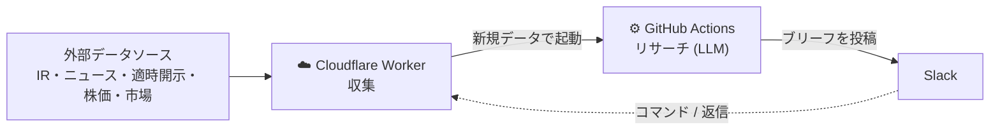

# stock-signals

半導体まわりの日本株を対象にした、ニュース駆動のリサーチ支援システム。
公式IR・ニュース・適時開示・株価などを自動で収集し、銘柄ごとの「生きたコンテキスト」を育てながら、
**判断材料 (材料ブリーフ)** を Slack に流し続ける。売買判断そのものは行わず、判断は読み手 (人間) が
行う。対象は数日〜3週間保有のスイング。

## セットアップ

```sh
make setup
```

その後 `worker/.dev.vars` に実値を埋める。skill-kit を最新にするときは `make update` を叩く。

## 全体構成

収集は Cloudflare Worker、リサーチは GitHub Actions 上の Claude Code (LLM) で完結する完全クラウド構成。



### Slack からの能動操作

コマンドは引数なしなら銘柄ピッカーが出る。

| 操作 | できること |
| ---- | ---- |
| `/brief [銘柄]`      | 材料ブリーフを今すぐ出す |
| `/crash [銘柄]`      | 暴落プリモーテム (崩れる道筋のリスク棚卸し) |
| `/context [銘柄]`    | 保存済みの銘柄コンテキストを表示する |
| `/position`          | 保有建玉を登録・上書きする |
| `/trade`             | 約定 1 回 (買い増し / 部分決済) を建玉に反映する |
| `/portfolio`         | 全建玉+現金を一括編集する |
| `/profile`           | 好み・リスク許容度・投資余力を登録する |
| `/mystatus`          | 登録済みのプロフィールと建玉を確認する |
| 投稿にスレッド返信     | 同じスレッドで Claude と対話する |

### 監視銘柄の追加・削除

`update-tickers` skill を手で叩く (`add <code>` / `remove <code>`)。
