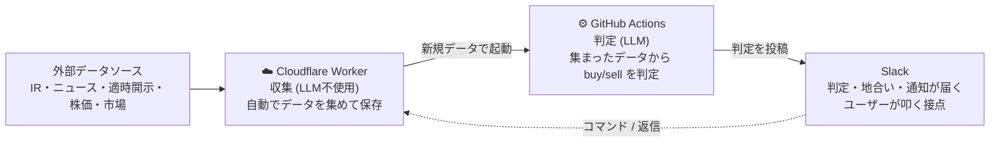

# stock-signals

半導体まわりの日本株を対象にした、ニュース駆動のスイング売買シグナル生成システム。
公式IR・ニュース・適時開示・株価などを自動で収集し、銘柄ごとの「生きたコンテキスト」を育てながら、
**buy/sell 判定**を Slack に流し続ける。取引自体は手動で、本リポは「売買判断の材料を非同期で
並べ続ける装置」。対象は数日〜3週間保有のスイングで、秒・分単位の板情報や歩み値は扱わない。

収集は Cloudflare Worker(LLM不使用)、判定は GitHub Actions 上の Claude Code(LLM)で完結する
完全クラウド構成。

## 全体構成

Cloudflare Worker (収集) と GitHub Actions (LLM判定) の2環境で完結する。
Worker が cron で集めた新規データを起点に、`context-builder` → `signal-judge` の2段が
`repository_dispatch` で連鎖する (詳細は後述の「構成思想」を参照)。

この図は3環境の流れだけを示す。各部の設計判断は後述の「構成思想」、
実装の詳細(テーブル構成・エンドポイント・skill の入出力)はコードが真のソース。

上の図は**ユーザーが何もせず自動で受け取るもの**: 寄り前の地合い、新着データを起点にした
buy/sell 判定、コンテキスト更新、新規IR通知。これらは Worker の cron / dispatch で勝手に流れる。
**ユーザーが Slack から能動的に叩けるもの**は後述の「Slack からの能動操作」を参照。

### Cron スケジュール

収集 (Worker) は JST 基準で寄り前・場中5分毎・引け後に走る(東証が開かない土日はスキップ)。
GitHub Actions の workflow は **schedule cron を持たず**、すべて Worker の dispatch か Slack
スラッシュコマンド/スレッド返信で起動する。地合いの `market-check` は寄り前に premarket を取得した
直後、個別 signal-judge の **前段ゲートとして先に** 撃つ(手動実行も可)。具体的な cron 式と
種別ごとの収集内容は Worker の設定が真のソース。

### LLM連鎖 (新規データ検知 → Slack)

Worker が新規 IR/ニュース/開示/レーティングを検知すると、`context-builder`(銘柄コンテキストを
更新)→ `signal-judge`(buy/sell を判定)が dispatch で連鎖し、Slack に流れる。スレッド返信には
`slack-reply` が同じスレッドへ返答する。各段の入出力は workflow / skill が真のソース。

取得済み位置を示すカーソルは本文と同じ行で持ち、context-builder が **本文とカーソルを一度に
原子的に前進させる**(本文だけ進む/カーソルだけ進む を構造的に排除)。前段のジョブが途中で
キャンセルされてもカーソルは更新されず、次の発火で取りこぼし分を含めて再取得される (冪等)。
判定はカーソル以降を全部読む。

### Slack に流れてくるもの (自動)

ユーザーが何もせず自動で Slack に届く出力は次の4種類。

- **判定**: buy/sell + 水準修飾子 (押し目/追い/利確/逃げ) + 根拠が1行流れる。根拠には判定の核に
  なった「直近の重大トピック」が引用される。該当があれば末尾に強制フロー観測 (追証売り/踏み上げ) と
  指数リバランス窓が観測事実として相乗りする (判定とは独立)。
- **地合い**: 寄り前に `リスクオン / 中立 / リスクオフ` + 当日の売買可否 (`拾い場 / 様子見 / 守り`) を
  1本出す。個別 buy/sell の前に「今日エントリーしてよい地合いか」を見るゲート。
- **コンテキスト更新**: context-builder が銘柄コンテキストを育てるたび、更新後の本文全文を
  コンテキスト更新チャンネルに投稿する (判定チャンネルとは分離)。コンテキストの育ちを覗く窓。
- **新規IR**: 新着IRを通知する。判定とは別チャンネルに分けることもできる。

銘柄コンテキスト自体は人間が直接見るものではなく、context-builder が書き signal-judge /
crash-scenario / slack-reply が読む内部ストア (更新のたび上記「コンテキスト更新」として流れる)。

### Slack からの能動操作

ユーザーが Slack から能動的に叩けるのは次の通り(コマンドは引数なしなら銘柄ピッカーが出る)。

| 操作 | できること |
| ---- | ---- |
| `/signal [銘柄]`     | 任意のタイミングで buy/sell 判定を出す(自動判定と同じ skill を手動起動) |
| `/crash [銘柄]`      | 暴落プリモーテム。崩れる道筋を銘柄固有/マクロの両面で3〜5本列挙する(判定とは別物のリスク棚卸し) |
| `/position`          | 保有建玉を登録する(Slack ユーザー単位)。スレッド返信時に本人の含み損益として効く |
| `/add-ticker [銘柄]` | watchlist に銘柄を1つ足す |
| 解析投稿にスレッド返信 | 同じスレッドで Claude と対話する。コンテキスト+数値+本人の建玉を読んで答える |

`/crash` と `/signal` は dispatch 先(crash-scenario / signal-judge)を切り替えるだけで流れは同じ。
`/position` は dispatch せず建玉登録フォームを開く別系統で、入力を Worker が保存する(LLM は介さない)。

**場中ニュースのデバウンス**。場中 (5分毎) は同じ銘柄に短時間で複数の新着が出ると判定が数分おきに
連発するため、**15分以内に既に撃っていればその回は見送る** (見送り分は冪等性で次スロットがまとめて拾う)。
寄り前/引け後の intake は地合い込みの重要判定なのでデバウンスせず常に判定する。

## 構成思想

全体像を踏まえた上での、各部の設計判断。

- **収集は決定論、判定だけ LLM**。記事・株価・ファンダ・適時開示・レーティングの取得は素のスクレイプで Worker が担う。skill が読むインプット(コンテキスト本文・数値・需給イベント)の取得・正規化も Worker のバンドルエンドポイントが1 callで返し、skill はそれを読むだけ。決定論的な前処理はすべて Worker 側に寄せている。
- **判定は2段に分離**。前段 `context-builder` が銘柄ごとの **D1 コンテキスト** を「持続コンテキスト(経営判断・商品ラインナップ・技術ロードマップ + 直近の重大トピック要約)」として育て、後段 `signal-judge` がそのコンテキスト+価格/地合いを読んで buy/sell を判定する。
- **判定は必ず buy か sell の2値**。薄い材料でも片側に倒す。方向に「水準」修飾子 (押し目/追い/利確/逃げ) を添えて、トレンド内のどこにいるかを示す。
- **出力の住み分け**。D1 コンテキスト = 銘柄を読み解く生きたナレッジ(context-builder が書く)。判定 (buy/sell) = Slack に流れる(signal-judge が書く)。コンテキストは人間が直接見るものではないが、更新のたび全文が Slack のコンテキスト更新チャンネルに投稿される(覗き窓)。
- **記事系は1つに合流**。公式IR・銘柄ニュース・適時開示(TDnet)・証券会社レーティングはすべて同じ記事ストアに保存され、収集元が増えても context-builder は無改修で読む。レーティングは目標株価が中期(6〜12ヶ月)ビューなので、context-builder がコンテキストの専用セクションに畳み込む。
- **判定は地合いを潜らせる**。`market-check` が市場全体の地合い(リスクオン/中立/リスクオフ)を寄り前に1本決め、当日の個別 buy/sell はそれを潜って出る — **リスクオフの日は水準が押し目に格下げされ追いが封じられる**。
- **判定本文に観測事実を相乗り**。強制フロー(追証売り/踏み上げ)とスケジュール型イベント(FOMC/日銀/SOX系ピア決算)を、方向判断とは別の観測事実として判定に織り込む(前者は本文末尾に1行、後者は判定の入力に1行)。

## ディレクトリ構成

| パス | 中身 |
| ---- | ---- |
| `worker/`            | Cloudflare Worker (収集) |
| `.github/workflows/` | LLM判定の Actions(market-check / context-builder / signal-judge / crash-scenario / slack-reply)・CI・デプロイ |
| `agents/skills/`     | Claude Code skill 実体(`.claude/skills/` は symlink) |
| `scripts/`           | Slack 投稿整形・判定 dispatch・手動ツール・品質ゲート(`verify.sh` 等) |
| `config/`            | sources / events / peers の人間向け設定。銘柄一覧の真ソースは `worker/src/lib/watchlist.ts` の `TICKERS` |

> Slack App の登録・Worker / GitHub Actions の secret 設定といった構築手順は、利用ではなく
> セットアップの領域なので各 skill (`agents/skills/`) とワークフロー (`.github/workflows/`) を参照。